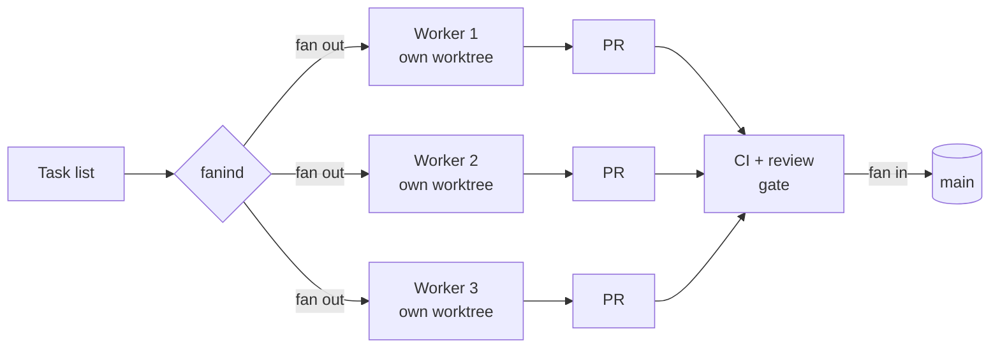

<p align="center">
  <picture>
    <source media="(prefers-color-scheme: dark)" srcset="docs/brand/logo/fanin-lockup-horizontal-dark.svg">
    
  </picture>
</p>

<p align="center"><strong>Fan out to coding agents. Fan in to main.</strong></p>

<p align="center">
  <a href="https://github.com/polandy/fanin/actions/workflows/ci.yml"></a>
  <a href="LICENSE"></a>
  <a href="go.mod"></a>
  
</p>

fanin runs coding agents on your projects' task lists and brings their work back to `main`. For each task it
starts one fresh worker (Claude Code, opencode, …) in its own [herdr](https://github.com/herdrdev/herdr) pane and
worktree, watches it until it reports, and turns the result into one reviewable pull request.

> **Status: concept.** `fanind` serves its store over a read-only API and `fanin status` reads it; no workers run
> yet. See [Status](#status).

## Why fanin

- **One task, one worker, one PR.** Every task gets a fresh agent in an isolated worktree and ends as a single
  pull request you can review.
- **The forge decides what merges.** Branch protection, required checks and the forge's merge queue gate the PR.
  A review check counts like CI. fanin adds no merge logic of its own.
- **You are asked only when it is yours to decide.** Questions come with options and a recommendation, and can be
  answered from the CLI, an agent session or a UI.
- **No agent session has to stay open.** A daemon drives the work; state lives in SQLite, so a restart picks up
  where it stopped.
- **You can watch and take over.** Workers run in terminal panes, not behind a curtain.

## How it works



- `fanind`, a Go daemon, holds a scheduler, a SQLite store and adapters for worker runtimes and forges.
- `fanin`, the CLI, adds tasks, answers questions and shows what runs.
- Workers report a structured result through a small MCP tool; pane text is read only to spot dialogs and stalls.
- A review run posts its verdict as a commit status that branch protection requires, next to CI.
- On GitHub the PR is set to auto-merge; on Gitea or Forgejo it merges when checks succeed.
- Runs are bounded: a spent worker is replaced by a fresh one with a structured handover.

## Status

The plan below is built. The bash loops are retired project by project, following the
[cutover runbook](docs/dev/runbooks/cutover.md).

- [x] Behaviour of the existing bash orchestrator written down as acceptance scenarios
- [x] Config as validated YAML
- [x] Shadow store: `fanind` follows the old state and fills SQLite
- [x] Owner channel: questions answered through CLI, MCP and UI
- [x] New task shapes: analysis tasks end to end (alerts follow)
- [x] The PR path moves to fanin, project by project
- [x] The bash loops are retired

The full plan is in [`docs/dev/concept.md`](docs/dev/concept.md#migration).

## Documentation

- [Concept and decisions](docs/dev/concept.md)
- [Acceptance scenarios](docs/dev/scenarios.md)
- [Cutover runbook](docs/dev/runbooks/cutover.md)
- [Coding guidelines](docs/dev/guidelines.md)
- [Configuration](docs/user/configuration.md) and [operation](docs/user/operation.md)
- [Brand files](docs/brand/README.md)

## Contributing

You need Go (the version in `go.mod`), `make` and `shellcheck`.

```sh
make ci    # gofmt, shellcheck, go vet, go build, go test, private-data checks
```

See [`CONTRIBUTING.md`](CONTRIBUTING.md).

## License

Apache License 2.0, see [`LICENSE`](LICENSE) and [`NOTICE`](NOTICE). The brand files in
[`docs/brand/`](docs/brand/) use the same license; the Geist fonts there stay under the SIL Open Font License.
